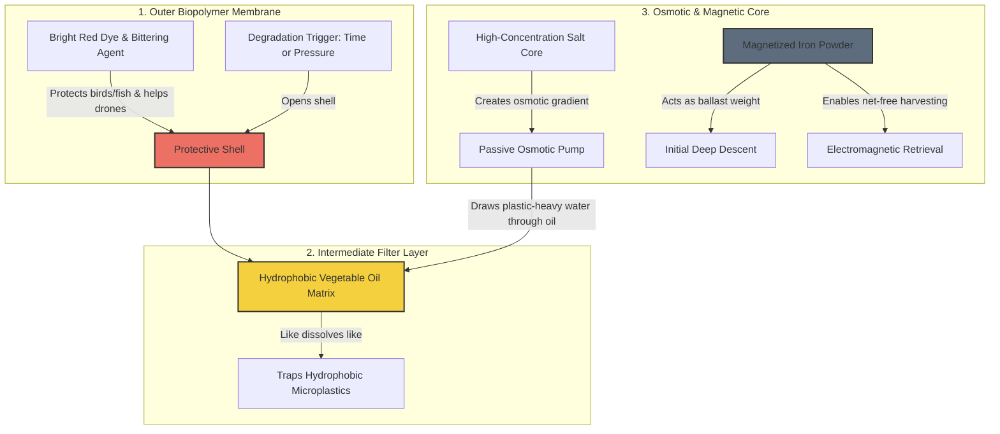
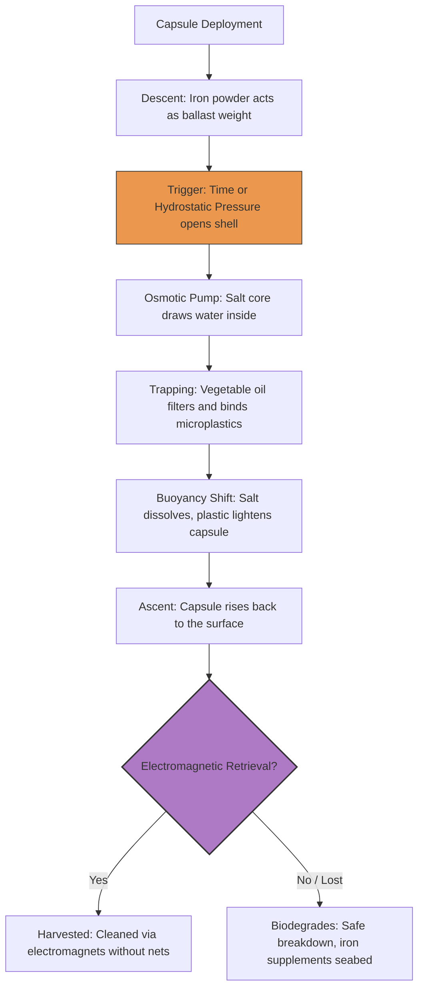

# 🌊 Zero Waste Cleanup: Passive Microplastic Magnetic Catcher

This project introduces a 100% biodegradable, non-electric, and zero-waste capsule designed for large-scale microplastic removal from oceanic and marine environments. Operating entirely on natural physical and chemical principles, the capsule captures microplastics and transitions into a magnetic state for rapid, net-free harvesting.

## 🛠️ Technical Design & Architecture

The capsule consists of three strategically layered biomaterial components that trigger specific chemical and mechanical reactions over time or at depth:

*   **1. The Protective Outer Shell (Biopolymer Membrane):** 
    *   **Trigger Mechanisms:** The outer membrane is engineered with two optional deployment modes: **Time-Based Dissolution** (dissolving at a linear, predictable degradation rate) or **Depth-Responsive Pressure Activation** (rupturing via hydrostatic pressure at a specific targeted depth).
    *   **Avian & Marine Protection:** The shell is dyed bright **red**. Based on ocean physics, red light is filtered out completely within the first few meters of water depth, making the capsule look like an invisible, non-food item (grey/black stone) to deep-sea fish. For surface birds, the shell is infused with a natural bittering agent, ensuring birds instantly reject it if tasted. The red color also ensures effortless visual spotting for retrieval drones on the surface.

*   **2. The Hydrophobic Core (Vegetable Oil Matrix):** 
    *   **Plastic Binding Affinity:** The interior space is filled with sustainable vegetable oil. Based on the chemical law of *"like dissolves like"*, both microplastics and organic oils are highly hydrophobic (water-repelling). When plastic particles collide with the exposed oil matrix, they partition into the oil phase and become permanently trapped inside the capsule core.

*   **3. The Osmotic & Magnetic Core (Salt & Magnetized Iron Powder):**
    *   **Passive Osmotic Pump:** At the absolute center sits a high-concentration salt core. When the outer membrane activates, seawater comes into contact with the salt. The sudden osmotic gradient creates a mechanical pumping effect, drawing microplastic-heavy water directly through the oil filter layer.
    *   **Magnetized Iron Powder:** Mixed within the core is non-toxic, magnetized iron powder, which initially serves as a physical ballast weight to pull the capsule down into the water column. As the salt dissolves and the oil traps the light plastic particles, the capsule gains buoyancy to rise back toward the surface. The iron powder turns the entire capsule into a highly magnetic target, allowing cleanup vessels to harvest thousands of capsules instantly using high-powered electromagnets without using disruptive trawling nets.

## 🔄 Environmental Lifecycle (Zero Waste)

If a capsule is lost or evades magnetic retrieval, it poses **zero environmental hazard**. Every single component—from the outer biopolymer to the vegetable oil and salt core—is fully biodegradable and non-toxic. The iron powder returns to the seabed as a natural iron supplement for marine flora.

## 📄 License

This project is licensed under the **MIT License** – preserving the original architecture credited to the creator.

Copyright (c) 2026 masakertsa
