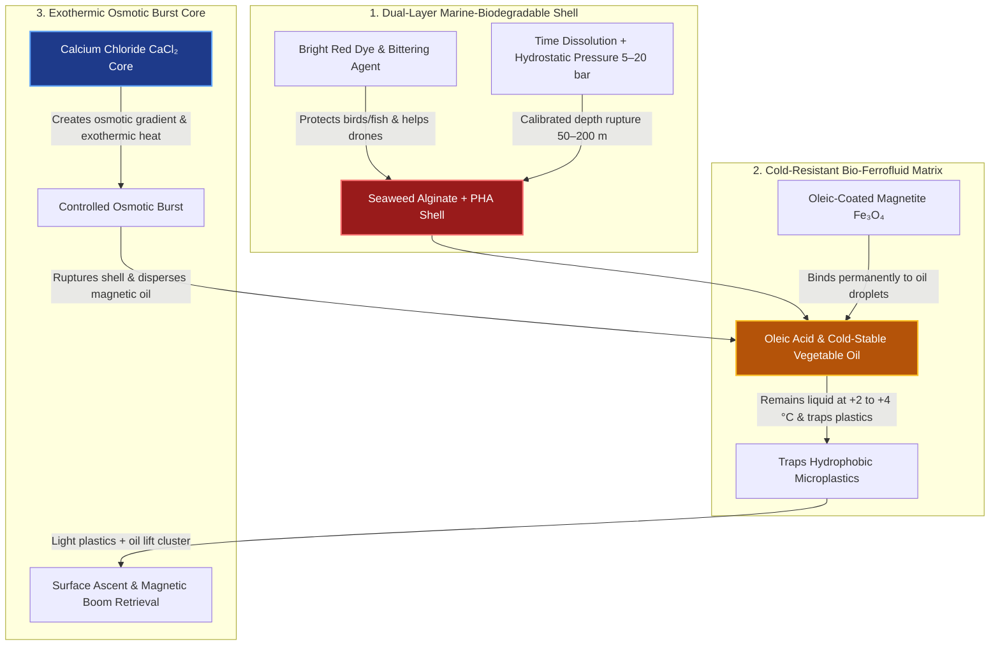
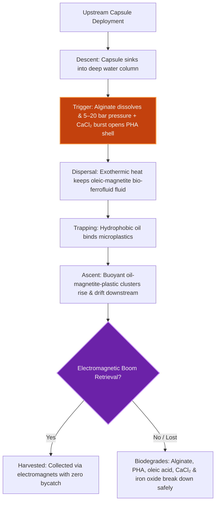

🌊 Zero Waste Cleanup: Passive Deep-Water Microplastic Magnetic Catcher

This project introduces a 100% marine-biodegradable, non-electric, and zero-waste capsule designed for large-scale microplastic removal from oceanic and deep-water environments. Operating entirely on natural osmotic pressure, hydrophobic oil-binding, and ocean current dynamics, the capsule captures subsurface microplastics and transitions into a buoyant magnetic state for rapid, net-free harvesting.

🛠️ Technical Design & Architecture

The capsule consists of three strategically layered biomaterial components engineered for cold, high-pressure deep-sea environments:
• 1. The Dual-Layer Marine-Biodegradable Shell (Seaweed Alginate + PHA):
	• Time- & Pressure-Controlled Activation: Unlike standard PLA bioplastics that require industrial composting heat (+60 °C) and persist in cold oceans, this capsule uses an outer seaweed alginate film (for time-controlled dissolution) paired with a rigid PHA (polyhydroxyalkanoate) inner shell that degrades in cold marine sediment and ruptures at calibrated hydrostatic pressure (5–20 bar at 50–200 meters depth).
	• Avian & Marine Protection: The shell is dyed bright red. Based on ocean physics, red light is filtered out completely within the first few meters of water depth, making the capsule look like an invisible, non-food item (grey/black stone) to deep-sea fish. For surface birds, the shell is infused with a natural bittering agent, ensuring birds instantly reject it if tasted. The red color also ensures effortless visual spotting for retrieval drones on the surface.
• 2. The Cold-Resistant Bio-Ferrofluid Matrix (Oleic Acid + Magnetite Fe₃O₄):
	• Deep-Sea Viscosity Control: At deep-water temperatures of +2 °C to +4 °C, standard vegetable oils solidify. The matrix uses cold-resistant oleic acid (with a low solidification point) blended with refined plant oils so the carrier remains fluid in cold currents.
	• Plastic Binding Affinity: Based on the chemical law of "like dissolves like", both microplastics and organic oils are highly hydrophobic (water-repelling). Non-toxic magnetite (Fe₃O₄) nanoparticles coated with hydrophobic oleic acid bind permanently to the oil droplets, turning the entire oil-plastic cluster into a cohesive magnetic target as microplastics partition into the oil phase.
• 3. The Exothermic Osmotic Burst Core (CaCl₂):
	• Exothermic Osmotic Pump: At the absolute center sits a calcium chloride (CaCl₂) salt core. When seawater permeates the inner membrane, CaCl₂ generates a powerful osmotic gradient while releasing mild exothermic heat that keeps the surrounding oil matrix fluid.
	• Controlled Osmotic Burst & Ascent: Rising internal pressure ruptures the PHA shell in a controlled burst, dispersing the magnetic bio-ferrofluid droplets into the water column. As the salt dissolves and the oil binds low-density microplastics, the buoyant clusters rise back to the surface for rapid, net-free collection via electromagnetic booms or cleanup vessels.

🧭 Ocean Current Logic: Upstream Deployment & Downstream Retrieval

Capsule deployment utilizes predictable ocean currents and upwelling zones as a zero-energy conveyor belt:
• Upstream Release: Guided by satellite current mapping, capsules are deployed upstream of known coastal currents, oceanic gyres, or river plumes.
• Passive Subsurface Sweep & Boom Capture: As capsules sink, burst at target depth, and ascend with bound microplastics, prevailing currents transport the buoyant magnetic clusters directly into anchored electromagnetic booms or skimming vessels stationed downstream.
• Geographic Choke-Point & Strait Funneling:** Rather than relying solely on unpredictable open-ocean gyres, deployment is optimized for natural coastal bottlenecks—such as narrow straits, island channels, and major river estuaries. In these predictable high-throughput corridors, local bathymetry and tidal currents naturally funnel rising magnetic oil-plastic clusters into a narrow capture zone, allowing compact, anchored electromagnetic booms to harvest microplastics with maximum efficiency.

### ⏱ Hydrodynamic Drift Calibration (Current Velocity × Cycle Time)

Because ocean currents continuously transport the capsule horizontally during descent, osmotic activation, and ascent, release coordinates are calibrated directly against local current velocity:

- **Drift-Distance Formula ($d = v \times t$):** Upstream release distance ($d$) is calculated by multiplying local current speed ($v$) by the total subsurface cycle time ($t$ — controlled by the seaweed alginate shell thickness and target depth).
- **Precision Surface Arrival:** By matching shell dissolution time to current velocity, buoyant magnetic oil-plastic clusters surface right inside the capture corridor ahead of the downstream electromagnetic booms, preventing premature dispersion in fast currents or early surfacing in slow waters.

🔄 Environmental Lifecycle (Zero Waste)

If a capsule or cluster evades magnetic retrieval, it poses zero environmental hazard and produces zero bycatch (unlike fine-mesh trawling nets). Every single component—seaweed alginate, PHA biopolymer, plant-derived oleic acid, calcium chloride, and iron oxide—degrades naturally in cold seawater without leaving microplastics or toxic residues.

📄 License

This project is licensed under the MIT License – preserving the original architecture credited to the creator.
Copyright (c) 2026 masakertsa
